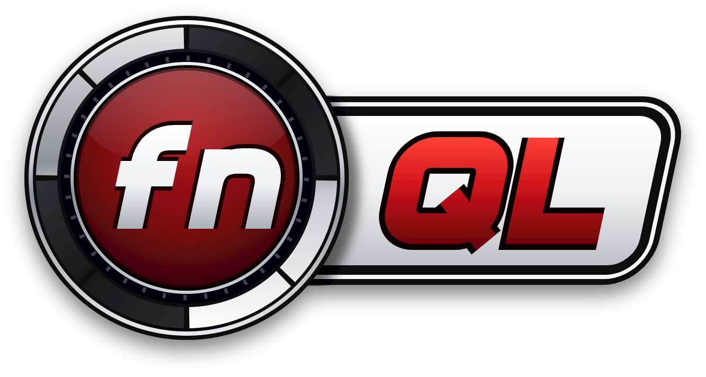
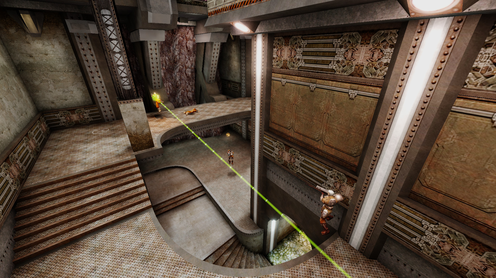
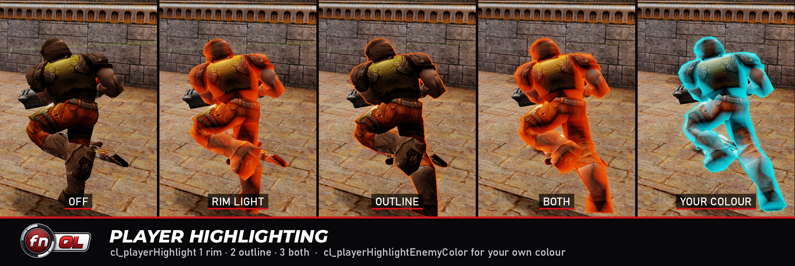
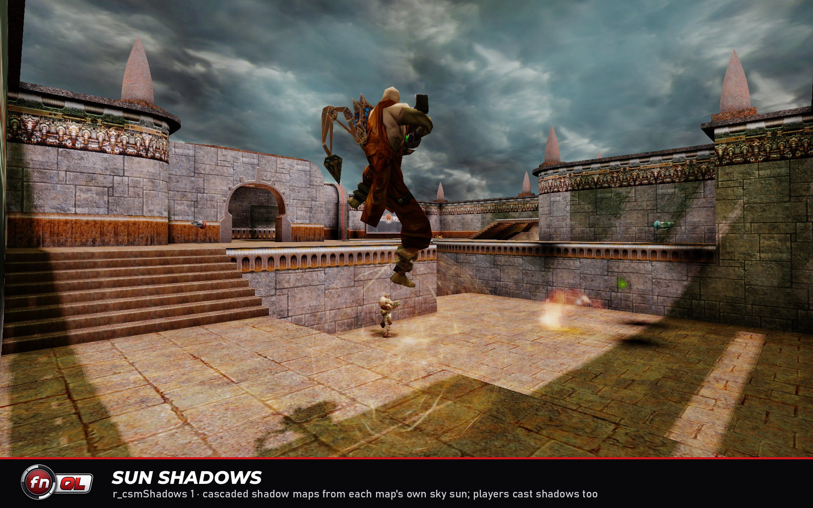
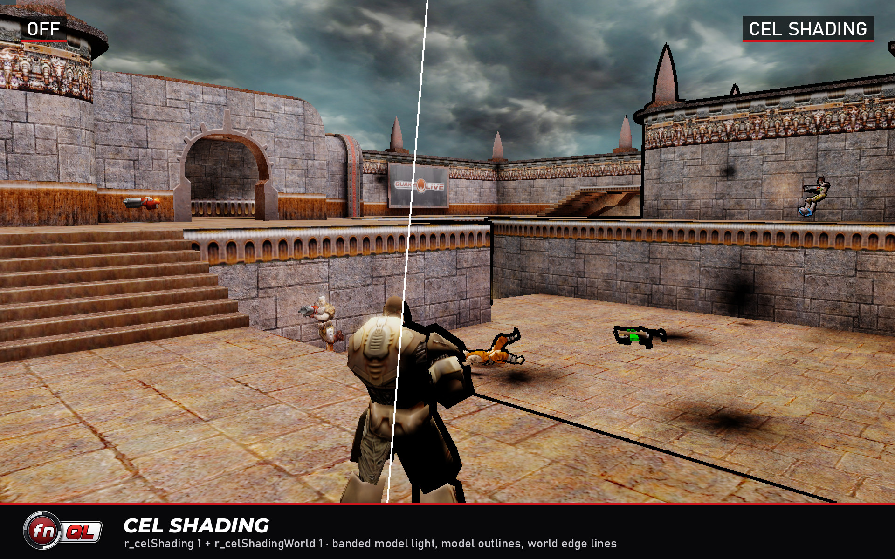
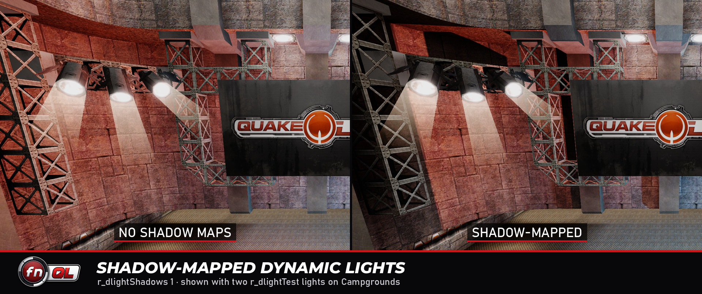
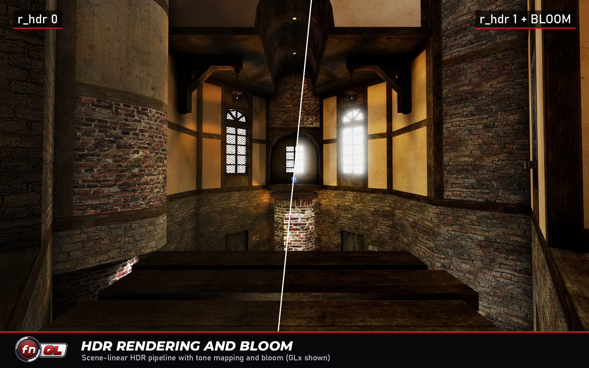

### Fappin' Quake Live

**An open-source engine for the Quake Live you already own.**

  
  
  
  
  

*Compatibility target: Retail Quake Live (Steam) · Version line: `0.1.0` · [Release history](https://github.com/themuffinator/FnQL/releases)*

## 1. Introduction

**FnQL** is a modernized engine for the retail Steam release
of Quake Live. It keeps the game you know, then adds faster rendering, modern
audio and input, stronger platform support and a long list of quality-of-life
improvements inherited from FnQ3 and Quake3e.

Retail compatibility comes first:

- **FnQL players join retail servers**, and **retail players join FnQL
  servers** and receive exactly what a retail server would send them.
- Your install, profile, configs, `.dm_91` demos, maps and Workshop content
  keep working.
- Steam authentication goes through Steam's own session tickets and is never
  faked.

FnQL is engine-only. It does not reconstruct or distribute Quake Live game
code or assets, so a legitimate
[Quake Live installation on Steam](https://store.steampowered.com/app/282440/Quake_Live/)
is required.

| | |
| --- | --- |
| **Official packages** | Windows x86 client · Linux i686 dedicated server |
| **Requires** | Quake Live on Steam (app 282440), launched once |
| **Licence** | GPL-2.0 engine; see [What's in a package](#whats-in-a-package) |
| **Lineage** | Quake III Arena GPL source → ioquake3 → Quake3e → FnQ3 → FnQL |

## 2. Features

- **Extensive Quake Live compatibility** — built around the retail Steam
  release, with support for official assets and game modules, protocol 91
  networking, `.dm_91` demos, BSP v47 maps, advertisements, factories, player
  profiles, the retail WebUI, Steam integration and Workshop content.
- **Fast, modern hardware rendering** — choose between optimized **GLx** and
  **Vulkan** renderers, plus an experimental **Vulkan RTX** module, with
  GPU-cached world geometry, optimized lightmaps, reduced rendering overhead,
  improved depth precision and better performance on large or demanding maps.
- **Modern visual upgrades** — optional HDR rendering and output, MSAA,
  supersampling, render scaling, anisotropic filtering, bloom, tone mapping,
  colour grading, shadow-mapped dynamic lights, sun shadows from each map's
  own sky, motion blur, lens flares, soft particles, enhanced liquids and
  per-map fog.
- **Improved player visibility** — optional player rim lighting, stencil
  outlines or both, with configurable enemy, teammate, team and free-for-all
  colours, intensity and outline thickness. Cel shading, model outlines and
  world-edge outlines are also available.
- **Better modern hardware and OS support** — native Win32 and X11 video and
  input in release builds (SDL3 for source builds), OpenAL audio, modern
  graphics APIs, high-resolution and high-refresh displays,
  borderless/windowed/fullscreen modes, fast Alt+Enter switching and improved
  compatibility with current desktop systems.
- **Low-latency, configurable controls** — raw mouse input, Quake
  Live-accurate CPI scaling, signed acceleration, sensitivity caps and
  angle-history filtering, while retaining classic Quake3e/ioquake3 mouse
  styles. Controllers, including Quake Live's analog gamepad mapping on
  Windows, and Unicode text input are also supported (enable controllers
  with `in_joystick 1`; SDL builds add controller hotplugging).
- **Modern spatial audio** — OpenAL and HRTF headphone positioning, surround
  output, reverb, geometry-based occlusion, output-device selection, live
  device recovery and automatic fallback to the classic software mixer.
- **Major quality-of-life improvements** — scalable TTF console text, smooth
  scrolling, mouse selection, clipboard support, drag-and-drop editing, live
  command/CVar/map completion, minimize hotkeys, focus muting, lower
  background CPU usage and more flexible player configuration.
- **Better screenshots, video and streaming tools** — PNG, TGA, JPEG and BMP
  capture, clipboard screenshots, custom filenames, camera metadata,
  configurable levelshots, watermarks, cubemap capture, arbitrary-resolution
  output, FFmpeg video piping and a windowless capture client.
- **Faster content handling** — quicker startup and map restarts with large
  PK3 libraries, raised filesystem and map limits, fast redirected downloads
  and automatic handling of server-required Workshop content.
- **Greater stability and security** — extensive Quake3e and FnQ3 bug fixes,
  improved memory management, lower memory usage, stronger network
  protection, hostile-content checks on downloaded packages and graceful
  fallbacks when optional rendering, audio, WebUI or Steam functionality is
  unavailable.

### See it

Each comparison is one moment of play with only the feature changed. All of
these looks are optional.

  

| | |
| :---: | :---: |
|  **Sun shadows** (`r_csmShadows 1`) |  **Cel shading** (`r_celShading 1`) |
|  **Shadow-mapped dynamic lights** (shown with test lights) |  **HDR and bloom** (`r_hdr 1`) |

## 3. Getting Started

Install [Quake Live through Steam](https://store.steampowered.com/app/282440/Quake_Live/)
and launch the retail game once, so Steam creates its normal files and your
player profile. Then download the package for your platform from the
[latest FnQL release](https://github.com/themuffinator/FnQL/releases/latest).

### Windows client

1. In Steam, right-click Quake Live → **Manage** → **Browse local files**, and
   extract the Windows `.zip` into that folder.
2. Keep `FnQL-pkg.fnz`, `fnql-web.pak`, the renderer modules and the packaged
   runtime libraries beside `fnql.exe`.
3. Leave Steam running and launch `fnql.exe`.

FnQL's files sit beside the retail ones; `quakelive_steam.exe` keeps working
as before. The official build is Win32/x86 so it can load the retail game
modules and WebUI.

### Linux dedicated server

1. Install the 32-bit runtime libraries reported by `ldd ./fnql.ded` on your
   distribution. The release is i686 so it can load retail
   `qagamei386.so` from `baseq3/bin.pk3`.
2. Extract the archive with
   `tar -xzf fnql-*-linux-x86.tar.gz -C "<Quake Live folder>"`. The tarball
   preserves the executable bits on the engine and renderer modules.
3. From that folder, start the server with
   `./fnql.ded +set fs_steampath "$PWD" +set dedicated 2 +map campgrounds ffa`.
   Keep the two FnQL package sidecars and renderer modules beside the binaries.

FnQL discovers conventional Steam libraries on each supported OS; for a
custom library use `+set fs_steampath "<Quake Live folder>"`. Optional Steam
and WebUI services fail safely when unavailable.

### Game modules

Every package puts the clean-room game modules of the companion
[FnQL-game](https://github.com/themuffinator/FnQL-game) project in `baseq3/`,
and FnQL uses them by default. Retail clients join FnQL servers running the
FnQL-game game module and see what a retail server would send them.

| Cvar | Values | What it picks |
| --- | --- | --- |
| `vm_gameProvider` | `auto` (default), `fnql`, `retail` | Server game module |
| `vm_cgameProvider` | `auto` (default), `fnql`, `retail` | Client game module |
| `vm_uiProvider` | `auto` (default), `fnql`, `retail` | Menu module |

`auto` takes an FnQL-game module that declares retail wire parity, as the
bundled ones do, and falls back to the retail module when it is missing.
`vminfo` shows which module is active. A configuration written by an
earlier FnQL release holds `vm_gameProvider "retail"`, its old default; FnQL
moves it to the new default once, so set the provider again afterwards to
keep the retail module.

On pure servers, FnQL-game's cgame and UI run only from the FnQL-game client
package, `baseq3/fnql_game_client.pk3`, which a pure FnQL server lists in
`sv_fnqlClientPaks`. On any other pure server, retail ones included, FnQL
loads the retail cgame and UI, so the client never reports a module it did
not run. Retail clients never need the package, and an operator can stop
offering it with `sv_fnqlClientModules 0`.

### What's in a package

- The Windows package contains FnQL's open-source engine, its WebUI overlay,
  the FnQL-game modules and the compiled, closed-source Steam provider
  (`fnql_steam.dll`), which talks to the `steam_api.dll` from your own
  install.
- The Linux package contains only redistributable FnQL components and the
  FnQL-game modules.
- No package includes Valve's `steam_api.dll` or any retail game content.
- The FnQL-game modules combine FnQL-game's own code (GPLv2 or later) with
  baseq3a baseline code under id Software's Quake III Arena game-source
  license. See `docs/fnql/FNQL_GAME_BINARY_NOTICE.txt` and `docs/fnql-game/`
  in the package for the exact terms and source commit.

### Platforms and source builds

Retail Quake Live ships native Linux server modules, but its client and
WebUI modules are Win32-only, so the native Linux client is an
engine/platform development target rather than a retail-play path. FnQL does
not support or build macOS: retail ships no macOS game, client, UI or QVM
modules, and FnQL will not reconstruct them.

FnQL builds for 32-bit x86 and, on Windows and Linux, x86_64; its dedicated
server also builds for Linux aarch64, armv7l, ppc64le and ppc64. Releases
ship only the x86 packages: the other builds have no Steam integration,
WebUI or retail modules yet, so they are built from source and run the
FnQL-game modules. See the [Build Guide](BUILD.md).

### Headless and windowless runs

Dedicated executables and client launches with `+set dedicated 1` or `2`
start without graphical windows, renderer/audio initialization, or modal
prompts. Windows writes diagnostics to inherited stdout/stderr; redirect them
to a file or use `+set logfile 2`. Fatal errors exit with a nonzero status.
Use `+set com_headless 1` to explicitly select this mode (it also selects
dedicated mode). Headless processes cannot switch to a graphical client at
runtime. For the interactive Windows server console, explicitly pass
`+set com_headless 0`. Ordinary client launches are unchanged.

`+set com_headless 2` starts a windowless client for unattended runs and
captures: the renderer, audio settings and game run normally, but no window is
ever shown, the display mode and desktop gamma are left alone (fullscreen
requests stay windowed), and diagnostics go to stdout/stderr as in headless
mode. Screenshots and `video` captures come from the renderer's framebuffer
objects, so they show the real frame.

## 4. Documentation

### Player guides

- [Display Guide](docs/DISPLAY.md) for renderer selection, display modes, HDR,
  render scaling, anti-aliasing, bloom, lighting, shadows, fog, liquids, lens
  flares, motion blur, and other presentation controls.
- [RTX Renderer Guide](docs/RTX.md) for ray-tracing requirements, renderer
  selection, fallback behavior, safe starting settings, and troubleshooting.
- [Visuals Guide](docs/VISUALS.md) for player highlighting, team and enemy
  colours, cel shading, and outlines.
- [Aspect Handling Guide](docs/ASPECT_CORRECTION.md) for retail WebUI, menu,
  and cinematic layout behavior.
- [Audio Guide](docs/AUDIO.md) for backends, devices, HRTF, spatial effects,
  fallback behavior, and troubleshooting.
- [Console Guide](docs/CONSOLE.md) for console layout, scaling, completion,
  clipboard use, and mouse interaction.
- [Screenshot Guide](docs/SCREENSHOTS.md) for capture commands, formats,
  filenames, metadata, levelshots, watermarks, and cubemaps.
- [Release History](https://github.com/themuffinator/FnQL/releases) for
  published downloads and changelogs.

### Technical and build docs

- [Build Guide](BUILD.md) for compiling FnQL locally.
- [GLx Renderer Guide](docs/GLX.md) for GLx availability, diagnostics, and
  troubleshooting.
- [Input Compatibility Notes](docs/fnql/INPUT_COMPATIBILITY.md) for retail mouse
  math, text input, controllers, and preserved legacy input profiles.
- [WebUI Backend Notes](docs/fnql/WEBUI_BACKEND.md) for retail resources,
  platform boundaries, overlay order, and fallback rules.
- [Steam Provider Notes](docs/fnql/STEAM_PROVIDER.md) for the open loader ABI,
  separately distributed provider, and runtime policy.
- [RTX Renderer Contract](docs/fnql/RTX_RENDERER.md) for the renderer's Quake
  Live ABI boundary, conservative defaults, build gates, and runtime validation.
- [Game Modules](docs/fnql/GAME_MODULES.md) for module providers, the
  `vm_gameProvider` switch, and how FnQL hosts the clean-room modules of the
  companion [FnQL-game](https://github.com/themuffinator/FnQL-game) project
  without breaking retail interoperability.
- [Technical Notes](docs/fnql/TECHNICAL.md) for repository structure, release
  flow, compatibility workflow, and maintainer conventions.

## 5. Credits

FnQL follows a clear upstream lineage from the
[Quake III Arena SDK](https://github.com/id-Software/Quake-III-Arena), through
[ioquake3](https://github.com/ioquake3/ioq3),
[Quake3e](https://github.com/ec-/Quake3e),
[FnQ3](https://github.com/themuffinator/FnQ3), and
[QL-SRP](https://github.com/themuffinator/QL-SRP).

See [CREDITS.md](CREDITS.md) for the full credits, acknowledgements, and
trademark notice.

FnQL is an independent project and is not affiliated with, endorsed by, or
sponsored by id Software, Bethesda, ZeniMax Media, or Valve. Quake, Quake III
Arena, and Quake Live are trademarks of their respective owners.
